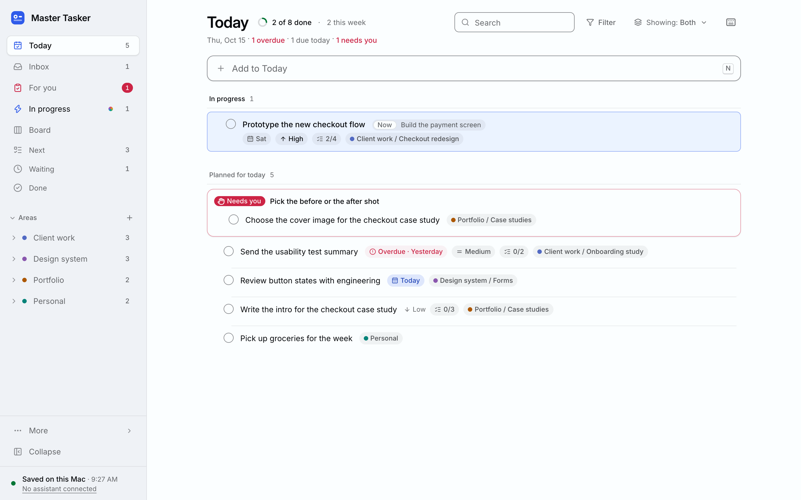

# Master Tasker

Master Tasker is a task board that runs on your own Mac, with your tasks kept in one file on that Mac. Connect an AI assistant, such as Claude, Codex, Copilot, Cursor or Gemini, and it can plan a task, work through it with you, and tell you plainly when something needs you.

It's for one person who wants their work and personal to-dos in one calm place, and wants an AI assistant to help with them, without a Master Tasker account or a cloud service.

<picture>
  <source media="(prefers-color-scheme: dark)" srcset="docs/screenshot-dark.png">
  
</picture>

## What you get

- **Areas and projects.** Start with Work and Personal, a sample set (Clients, Side projects, Pets, Home, Hobbies and Personal), or none. Rename, add or delete any of them.
- **Views.** Inbox for quick capture, then In progress, Today, Next, Waiting and Done. Every area and project has a board and a list.
- **Tasks** with notes, due dates, priorities, a next action, what you're waiting on, links and subtasks.
- **Work and Personal modes.** Show one side at a time, or both.
- **Fast.** Keyboard shortcuts for everything (press `?`), search, filters, and drag and drop that also works from the keyboard.
- **Safe.** Every change is in the activity history, deletes go to Trash first, and backups are automatic.
- **An AI assistant, if you want one.** Connect the app you already use. It plans a task's steps, works through them, and flags anything only you can do. Each step it ticks off shows on the card as it happens.

The first time you open it, a short setup asks three things: your name, which areas to start with, and whether to add sample tasks. Your name is optional. The app and your AI assistant use it, and you can change it any time in Settings. Skip setup and you get the sample set. Then a short tour shows how it works in three pictures. Take it again any time from More in the sidebar.

If you add the sample tasks, there are six, marked **sample**, each showing one idea. Clear them from the Getting started card on Today, or in Settings > Sample tasks, when you're ready.

## What you need

- **A Mac.** Master Tasker is Mac only for now.
- **Node.js 24 or newer**, the free software Master Tasker runs on. If your Mac doesn't have it, the installer offers to download a copy just for Master Tasker, with no password needed.
- **About 10 minutes.** Downloading and building take a minute or two. Most of the rest is the macOS security prompts and connecting your assistant.
- **For an AI assistant (optional):** an app that can run tools on your Mac, such as Claude, Codex, GitHub Copilot in VS Code, Cursor, Gemini CLI or Windsurf. The Claude extras need the [Claude desktop app](https://claude.ai/download) or [Claude Code](https://docs.claude.com/en/docs/claude-code/setup), and both need a paid Claude plan. Everything else works without any of them.

## Install

1. **Get the code.** On the [project's GitHub page](https://github.com/sgordon1024/master-tasker-app), press **Code**, then **Download ZIP**. Safari unzips it for you, so open the Master Tasker folder in Downloads (its name ends in `-main`). In other browsers, double-click the ZIP in Downloads first.
   If you use git, you can clone it instead: `git clone https://github.com/sgordon1024/master-tasker-app.git`
2. **Double-click Install Master Tasker.command** in that folder. A Terminal window opens and shows each step. Leave it open until it's done.
   The first time, macOS won't open it, because it came from the internet. [Here's how to open it](#if-macos-wont-open-the-installer).
3. **Answer its questions.** Press Return for yes. It only asks what it needs:
   - **"Move Master Tasker to your home folder now?"** if the folder is in Downloads, Desktop, Documents or iCloud Drive. macOS keeps background apps out of those folders. Yes moves it to a folder called `master-tasker` in your home folder and carries on from there.
   - **"Download a private copy just for Master Tasker (about 50 MB, no password needed)?"** if your Mac doesn't have Node.js. Yes downloads it from nodejs.org into the Master Tasker folder, where only Master Tasker uses it. To install Node.js for the whole Mac instead, answer `n`. The installer opens [nodejs.org/en/download](https://nodejs.org/en/download): press **macOS Installer (.pkg)**, not the commands, open the file it downloads and follow the steps. Then double-click the installer again.
   - **"Use port 4821 instead?"** if another app already uses Master Tasker's usual port, 4820.

   macOS may then show "Background Items Added" for "node". That's Master Tasker, set to start when you log in.
4. **Open it.** The installer opens **http://127.0.0.1:4820** in your browser. Bookmark it. In Safari, **File > Add to Dock** gives it an app icon.

It's safe to double-click the installer again. It updates the install in place.

### If macOS won't open the installer

On macOS 15 (Sequoia) or newer, the first double-click shows a message that starts *Apple could not verify "Install Master Tasker.command" is free of malware*. That's because it came from the internet, not the App Store.

1. Press **Done**.
2. Open **System Settings > Privacy & Security** and scroll down. Next to the message that "Install Master Tasker.command" was blocked, press **Open Anyway**.
3. macOS asks once more. Press **Open Anyway**, then type your Mac's password or use Touch ID. The installer starts.

On older macOS, Control-click (or right-click) the file, choose **Open**, then press **Open**.

**On a work Mac,** your company may hide **Open Anyway**. Use Terminal instead:

1. Open Terminal, in Applications > Utilities.
2. Type `cd ` (with a space after it), drag the Master Tasker folder onto the Terminal window, and press Return.
3. Type this and press Return:

   ```bash
   ./scripts/service.sh install
   ```

It does the same install and asks before downloading Node.js. It won't move the folder for you, so move it into your home folder first ([how](#if-something-goes-wrong)).

## Connect an AI assistant

In Master Tasker, open **Settings > AI assistants** and pick the app you use. Each one gets its own access to your tasks, and you can change or remove it any time. You can connect more than one.

| App | How it connects |
| --- | --- |
| Claude | One button each for Claude Code and the Claude desktop app. See [Claude](#claude) below. |
| Codex (ChatGPT) | A command to paste into Terminal. The ChatGPT desktop app, Codex CLI and the Codex IDE extension share it. |
| GitHub Copilot (VS Code) | Settings to paste into VS Code's MCP configuration. |
| Cursor | Settings to paste into `~/.cursor/mcp.json`. |
| Gemini CLI | Settings to paste into `~/.gemini/settings.json`. |
| Windsurf (Devin Desktop) | Settings to paste into `~/.config/devin/mcp_config.json`. Windsurf is now called Devin Desktop. |
| Other app | Settings for any other app that runs MCP servers on your Mac. |

For every app except Claude:

1. Pick the app.
2. Choose what it may do. Out of the box it can read your tasks and suggest changes, which wait in **For you** until you accept them. Turn on **Let it work on tasks** so it can plan a task, start it, tick off its steps and finish it.
3. Make the connection. Master Tasker shows the settings to paste and where they go, with this Mac's paths filled in. Paste them into the app.
4. Quit the app and open it again. Until it starts using its access, Master Tasker shows it as **Not used yet** and the sidebar says **Waiting for** the app. Once it does, it says **Connected**.

The settings name a file that holds the connection's token, readable only by you, so the token itself never goes in the app's settings. To see them again later, press **Show settings** on the app's row under **Assistants with access**. To do it all by hand, see [docs/MCP.md](docs/MCP.md).

How to start work on a task in each app, and what an assistant can and can't do, is in [docs/AI-ASSISTANTS.md](docs/AI-ASSISTANTS.md).

Assistants on the web, such as chatgpt.com and claude.ai, and phone apps can't connect. They only reach servers on the internet, and Master Tasker runs only on your Mac.

### Claude

In **Settings > AI assistants**, pick **Claude**. No Terminal needed.

1. The card at the top shows what this Mac has: the Claude app, Claude Code, the `/master-tasker` command, and Claude Desktop chat.
2. Press **Set up Claude Code**. This adds the `/master-tasker` command to Claude Code, with its own connection to your tasks. It also turns on **Link Claude threads to tasks**, so each task lists the Claude threads working on it.
3. Optional: press **Add to Claude Desktop** to use your tasks in any Claude chat, and in threads in the Claude app's Code tab too. Claude can read them and suggest changes. Suggestions wait in **For you** until you accept them. Quit Claude fully (Command-Q) and open it again to pick it up.
4. Open any task and press **Work on this with Claude**.

Each step says what it changes, and each one has a Remove button. If you'd rather use Terminal, `./scripts/install-skill.sh` does the same as **Set up Claude Code**.

The `/master-tasker` command, **Work on this with Claude**, linking Claude threads to tasks, Ask, routines and the daily review are Claude only. They're in [docs/CLAUDE-EXTRAS.md](docs/CLAUDE-EXTRAS.md).

## Everyday commands

Master Tasker starts on its own when you log in, so you don't need these day to day. They're for checking on it.

To run one, open Terminal in the Master Tasker folder: open Terminal (in Applications > Utilities), type `cd ` with a space after it, drag the Master Tasker folder onto the window and press Return. Then type the command and press Return.

| Do this | Command |
| --- | --- |
| Open it in your browser | `./scripts/service.sh open` |
| Is it running? | `./scripts/service.sh status` |
| Show the logs (Control-C to stop) | `./scripts/service.sh logs` |
| Restart | `./scripts/service.sh restart` |
| Stop until you log in again | `./scripts/service.sh stop` |
| Start | `./scripts/service.sh start` |
| Update | `./scripts/service.sh update` |
| Look around with made-up tasks | `./scripts/service.sh demo` |
| Uninstall (keeps your tasks) | `./scripts/service.sh uninstall` |

`demo` opens a separate copy at http://127.0.0.1:4870 that never touches your tasks, and deletes it when you press Control-C.

It restarts itself if it crashes or hangs. It's listed as "node" in **System Settings > General > Login Items & Extensions** (called Login Items before macOS 15). Switching that off stops it starting at login.

## If something goes wrong

The installer checks first and stops before it changes anything. It says what to do. The usual ones:

- **It says the folder is in Downloads, Desktop, Documents or iCloud Drive.** Double-click Install Master Tasker.command and answer yes when it offers to move the folder. Or move it yourself: in Finder, select the folder, press Command-C, choose **Go > Home**, then press Command-Option-V. Then double-click the installer in its new place.
- **It says Master Tasker needs Node.js.** Double-click the installer again and answer yes to the private copy. Or install Node.js for the whole Mac from [nodejs.org/en/download](https://nodejs.org/en/download): press **macOS Installer (.pkg)**, not the commands.
- **It says something else is using port 4820.** Double-click the installer again and answer yes to the next free port. Or quit the app that's using it.
- **An AI assistant can't reach Master Tasker after you moved the folder or changed the port.** Open **Settings > AI assistants**. For Claude, press **Set up again**. For other apps, press **Show settings** on the app's row and paste them into the app again. Updating a ZIP copy can also need **Set up again** for Claude.
- **Settings > AI assistants says Needs update for Claude Desktop chat.** Press **Update**, then quit Claude fully (Command-Q) and open it again.
- **An assistant says its connection was removed.** Connect it again in **Settings > AI assistants**, and paste the new settings into the app.

Logs, restore and more: [docs/OPERATIONS.md](docs/OPERATIONS.md).

## Update

If you cloned it with git, run this in the Master Tasker folder. It gets the latest version, rebuilds and restarts.

```bash
./scripts/service.sh update
```

If you used the ZIP:

1. Download the new ZIP.
2. Rename your old Master Tasker folder, for example to `master-tasker-old`.
3. Put the new folder in its place, with the old folder's name. If the new one is in Downloads, the installer can move it for you in the next step.
4. Double-click **Install Master Tasker.command** in the new folder. If it offers to download Node.js again, answer yes.

Your tasks aren't in that folder, so nothing is lost. If **Settings > AI assistants** then says **Set up again** for Claude, press it. Once it all works, drag the old folder to the Trash.

## Uninstall

Double-click **Uninstall Master Tasker.command** in the Master Tasker folder. Or, in Terminal:

```bash
./scripts/service.sh uninstall
```

While Master Tasker is still running, it undoes the Claude setups, if any, the same as pressing **Remove** for Claude in Settings > AI assistants. Then it stops Master Tasker and removes it from your login items. It keeps your tasks, and lists everything it left on the Mac and how to remove each one. Other AI assistants keep a `master-tasker` entry in their settings until you remove it there. Then drag the Master Tasker folder to the Trash.

To delete your tasks for good too: in Finder, choose **Go > Go to Folder**, type `~/Library/Application Support/MasterTasker` and press Return. Drag that folder to the Trash.

## Your data

- **Tasks and backups:** `~/Library/Application Support/MasterTasker/`
- **Logs:** `~/Library/Logs/MasterTasker/`
- **Backups** happen every day, and before every database upgrade, import and restore. The last 14 daily ones are kept. Make one any time, or restore one, in **Settings > Backups**. Time Machine backs these folders up too.
- **Export** everything as JSON from Settings > Backups.

The Master Tasker folder holds only the app, so you can move or replace it without losing anything. More in [docs/OPERATIONS.md](docs/OPERATIONS.md).

## Privacy

- Master Tasker runs only on your Mac and listens only on `127.0.0.1`. Nothing on your network or the internet can reach it.
- No accounts, no telemetry, no analytics. It never calls an AI model by itself.
- It reads other things on your Mac only after you turn them on:
  - **Claude Code's thread history** (`~/.claude/projects`), while **Link Claude threads to tasks** is on. It only reads, and keeps what it finds in your database.
  - **The Claude app's scheduled routines**, when you open **Routines** (turn it on in Settings > Labs).
  - **Code folders you name** for the optional daily review ([docs/REVIEW.md](docs/REVIEW.md)). None until you name them.
- **Ask** on a Needs you item runs Claude Code once, only when you press it, using your Claude plan.
- Each connection sees only the areas you pick, and you can pause it or remove its access in Settings > AI assistants. Tokens are saved readable only by you.
- When an AI assistant works on a task, what it reads goes to that assistant's provider, like anything else you type there, under your plan with them.

## Help and more

- [docs/AI-ASSISTANTS.md](docs/AI-ASSISTANTS.md): working with any AI assistant: starting work, Needs you, finished tasks, suggestions
- [docs/CLAUDE-EXTRAS.md](docs/CLAUDE-EXTRAS.md): the Claude extras: Work on this with Claude, thread linking, Ask, routines
- [docs/MCP.md](docs/MCP.md): connecting Claude, Codex, Copilot, Cursor, Gemini CLI, Windsurf and other apps by hand
- [docs/OPERATIONS.md](docs/OPERATIONS.md): settings, logs, backups, restore, troubleshooting
- [docs/REVIEW.md](docs/REVIEW.md): the optional daily review, for developers
- [docs/REBUILD.md](docs/REBUILD.md): the roadmap
- [SECURITY.md](SECURITY.md): what it protects against, and how to report a security problem
- [CONTRIBUTING.md](CONTRIBUTING.md): working on Master Tasker itself

## License

MIT. See [LICENSE](LICENSE).

Text is set in [Inter](https://rsms.me/inter/) by Rasmus Andersson, under the SIL Open Font License 1.1. Icons are from [Lucide](https://lucide.dev), under the ISC License.
